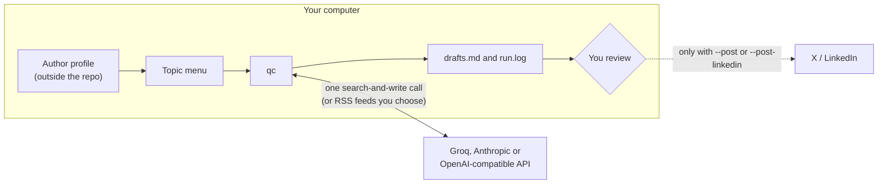

<p align="center">
  <a href="https://bearingquest.com">
    <picture>
      <source media="(prefers-color-scheme: dark)" srcset="docs/readme/bearing-quest-lockup-on-dark.svg">
      
    </picture>
  </a>
</p>

<h1 align="center">QuestCast</h1>

<p align="center">
  Daily X and LinkedIn post drafts from one recent source, in your voice.<br>
  Part of the <a href="https://bearingquest.com">Bearing Quest</a> project family.
</p>

<p align="center">
  <a href="https://github.com/BearingQuest/questcast/actions/workflows/ci.yml"></a>
  <a href="https://scorecard.dev/viewer/?uri=github.com/BearingQuest/questcast"></a>
  <a href="LICENSE"></a>
  
</p>

Pick a technology topic, and this finds one noteworthy recent item on it and
drafts two social posts from that same source: a short one for X and a longer,
opinionated one for LinkedIn. By default it runs on Groq's free tier, where one
call both searches the web and writes the posts. Anthropic's Claude, or any
OpenAI-compatible endpoint, can be swapped in with a flag, and RSS feeds you
choose can replace the web search.

> [!IMPORTANT]
> Human-in-the-loop by default. Nothing is published unless you pass `--post` (X) or `--post-linkedin` (LinkedIn); read each draft first.

The posts sound like *you* because of a profile file you write once and keep
outside this repo. That file is the whole idea: the code is a small harness,
and the profile is where the topics, the voice, the point of view, and the
guardrails live.

## How it works




Each run:

1. Asks which topic to cover — a numbered menu from your profile's `## Topics`
   section, or a built-in catalog of common IT areas. `--topic` skips the
   prompt, `--random-topic` rolls the dice.
2. Searches the web for a substantive recent item in that area, filtered by
   your **beat**: what counts as a good find, what to exclude, who it is for.
   With `--search rss` it chooses from your feeds' newest entries instead.
3. Skips anything already used, by URL or by title, tracked in `history.json`.
4. Writes two posts from that one source. The X version reports; the LinkedIn
   version argues — it takes a position, says what the item does not solve,
   and ends with a question worth answering.
5. Prints both drafts and appends them to `drafts.md` with the topic, source,
   and a one-line rationale for the pick.
6. Logs the outcome, success or failure, to `run.log`.

## Requirements

- Python 3.13 or newer
- macOS and Linux with Python 3.13+; iPhone via a-Shell with native search only (see
  [iPhone (a-Shell)](#iphone-a-shell))
- A free Groq API key — https://console.groq.com/keys
- Nothing else for the default setup: the `groq` and `openai-compat` providers
  use only the standard library. `--provider anthropic` needs the `anthropic`
  extra, pinned in `pyproject.toml`; see [Optional extras](#optional-extras).
  `--post` needs tweepy, installed by hand (see
  [Optional: publishing to X](#optional-publishing-to-x)).

## Install

Install the `qc` command from a tagged release (Python 3.13 or newer; `uv`
fetches it if you don't have it). Releases are listed at
https://github.com/BearingQuest/questcast/releases.

```bash
# uv, from the tag (needs git):
uv tool install git+https://github.com/BearingQuest/questcast@v3.1.1
# pipx, from the tag:
pipx install --python python3.14 git+https://github.com/BearingQuest/questcast@v3.1.1

# or from the release's wheel:
uv tool install https://github.com/BearingQuest/questcast/releases/download/v3.1.1/questcast-3.1.1-py3-none-any.whl
pipx install --python python3.14 https://github.com/BearingQuest/questcast/releases/download/v3.1.1/questcast-3.1.1-py3-none-any.whl
```

**First run.** Create the data directory and a profile to fill in, and the key
file, private from the start. Don't put the key on a command line: it would
stay in your shell history.

```bash
qc init                            # creates ~/QuestCast and author_profile.md
(umask 077; touch ~/.qc_post_env)  # empty file, readable only by you
ls -l ~/.qc_post_env               # -rw-------
```

Open `~/.qc_post_env` in an editor and add one line, with your own key from
https://console.groq.com/keys:

```
GROQ_API_KEY=<your key>
```

Then fill in `## Beat` and `## Voice` in `~/QuestCast/author_profile.md`
(see [Setup](#setup), step 3) and run `qc`.

**Upgrade** to a new release by installing its tag over the old one:

```bash
uv tool install --reinstall git+https://github.com/BearingQuest/questcast@v<new version>
pipx install --force --python python3.14 git+https://github.com/BearingQuest/questcast@v<new version>
```

**Uninstall:**

```bash
uv tool uninstall questcast   # or: pipx uninstall questcast
```

Your data folder, profile and key file are not touched; delete them by hand
if you want them gone.

**Verify a download.** Each release's wheel, source archive and SBOM carry a
build-provenance attestation. For a file you downloaded from the release (not
for an install from git), check it with the GitHub CLI:

```bash
gh attestation verify questcast-3.1.1-py3-none-any.whl -R BearingQuest/questcast
```

## Setup

There are two ways to run it:

- **Installed, as the `qc` command.** See [Install](#install). Once installed,
  `qc init` creates your data directory and a profile to fill in, and `qc`
  takes the same flags as `daily_post.py` below.
- **From a clone of this repo**, with `python daily_post.py`. The steps below
  cover this path; every command works the same as `qc`.

**1. Virtual environment.** Required on Homebrew and modern-distro Pythons,
which block system-wide pip installs per PEP 668. Nothing needs installing for
the default provider:

```bash
python3 -m venv ~/.qc_post_venv    # earlier installs: ~/.ai_post_venv still works for now
# only if you will use --provider anthropic, run from the clone:
~/.qc_post_venv/bin/pip install -e '.[anthropic]'
```

**2. API key**, in a protected file outside the repo:

```bash
(umask 077; touch ~/.qc_post_env)   # private from the start; ls -l shows -rw-------
```

Then open it in an editor and add `GROQ_API_KEY=<your key>`, so the key never
sits in your shell history. Use `ANTHROPIC_API_KEY` instead (from https://console.anthropic.com/settings/keys)
if you run `--provider anthropic`.

The script loads this at startup. An already-set environment variable wins,
which is handy for one-off overrides. The `export` prefix is optional but lets
the same file double as a shell-sourceable env file.

**3. Author profile — the important step.** Create it from the scaffold, then
fill it in:

```bash
~/.qc_post_venv/bin/python daily_post.py init    # installed: qc init
```

This creates the data directory (`~/QuestCast`, or `QC_POST_DATA_DIR`) with mode
700 if it doesn't exist, and copies `questcast/author_profile.example.md`
there as `author_profile.md`, with mode 600. It never overwrites an existing
profile: if one is there, it says so and exits without changing anything.

The scaffold explains each section:

| Section | What it does |
|---|---|
| `## Topics` | Your run-time menu of technology areas. Omit it to use the built-in catalog |
| `## Beat` | What makes an item worth posting *whatever* the topic: quality bar, exclusions, audience |
| `## Voice` | How you think and sound — your actual positions, plus real sentences you wrote |
| `## Experience` | Things you have really done that posts may reference, with a guardrail capping it at one per post |
| `## Never` | Hard rules: no employer names, no invented hands-on claims, whatever would misrepresent you |
| `## Hashtags` | A pool to draw from |
| `## Feeds` | RSS or Atom feed URLs, one per line. Used only with `--search rss` |

Beat and Voice are required. Spend your time on **Voice** — and especially on
pasting a handful of sentences you actually wrote. A description of your tone
produces competent generic prose; real samples give the model a cadence to
imitate. **Never** is what keeps a model trying to sound expert from inventing
credentials on your behalf.

Keep this file out of version control — it is personal, and it is already in
`.gitignore`.

## iPhone (a-Shell)

Dusten tested this on an iPhone on 25 Nov 2026, in [a-Shell](https://holzschu.github.io/a-Shell_iOS/)
with its Python 3.13 and QuestCast 3.1.1. It is tested, not supported: CI can't run a-Shell. iPad is
untested.

- **Install.** `pip install https://github.com/BearingQuest/questcast/releases/download/v3.1.1/questcast-3.1.1-py3-none-any.whl`.
  The `qc` command then works in a-Shell. Verifying the download with `gh attestation verify`
  (see [Install](#install)) happens on a computer.
- **Settings.** Only `Documents` is writable in a-Shell, so QuestCast's default folders can't be
  created. Put two lines in `~/Documents/.profile`, which a-Shell runs when it opens:

  ```bash
  export QC_POST_DATA_DIR="$HOME/Documents/QuestCast"
  export QC_POST_ENV_FILE="$HOME/Documents/.qc_post_env"
  ```

  Then run `qc init`.
- **Key.** Create `~/Documents/.qc_post_env` in an editor (`vim`) with one line,
  `GROQ_API_KEY=<your key>`. Use a separate key for the phone, so it can be revoked on its own.
- **Profile.** Copy your `author_profile.md` into a-Shell's `Documents/QuestCast` (AirDrop or Files).
  The example profile from `qc init` won't run: QuestCast stops and names the sections to fill in.
- **Search.** Native only (`--search native`). a-Shell's Python has Expat 2.6.4, and `--search rss`
  needs 2.7.2 or newer to protect against entity-expansion attacks in feed XML. Keep a-Shell in
  front while it runs.
- **Shortcut.** In Shortcuts, a Text action with three lines (the two `export` lines above, then
  `qc --search native --random-topic`), followed by a-Shell's Execute Command action. To put it on the
  Home Screen, follow Apple's guide:
  https://support.apple.com/guide/shortcuts/add-a-shortcut-to-the-home-screen-apd735880972/ios
- **History.** The phone keeps its own history, so duplicate checks don't span the phone and a
  computer.

## Optional extras

The Anthropic SDK for `--provider anthropic` is an optional extra, `anthropic`,
so the default install stays standard library only. Its exact version is pinned
in `pyproject.toml`. Install it from the repo clone, the route matching how you
run it:

```bash
# Installed qc command:
uv tool install --reinstall '.[anthropic]'
# A repo clone's virtual environment:
~/.qc_post_venv/bin/pip install -e '.[anthropic]'
```

`uv tool install --reinstall` replaces the whole tool environment, so a later
`uv tool install --reinstall .` without the extra drops it. In the venv, `-e`
links the install to this clone: `daily_post.py` and the venv both use the
clone's code, so a `git pull` needs no reinstall unless the pin in
`pyproject.toml` changes.

tweepy, for `--post`, isn't an extra yet: tweepy 4.17.0 requires oauthlib
below 4, and oauthlib 3.3.1 has open advisories fixed only in 4.0.0
(`docs/decisions.md`). Install it by hand in a clone's venv; see
[Optional: publishing to X](#optional-publishing-to-x).

## Usage

```bash
~/.qc_post_venv/bin/python daily_post.py
```

You get a topic menu, then both drafts print to the terminal and land in
`~/QuestCast/drafts.md`. Review, edit, post them yourself. Run whenever you like —
dedup makes irregular timing safe, and a second run the same day simply picks a
different item.

| Flag | Effect |
|---|---|
| *(none)* | Interactive topic menu, then draft both posts. The default |
| `--topic X` | Menu number, part of a menu entry, or free text not in the menu at all |
| `--random-topic` | Pick from the menu at random |
| `--list-topics` | Show the menu and exit |
| `--history` | Show the last 10 items used, with their topics |
| `--profile PATH` | Use a different profile file — handy for running more than one persona |
| `--provider NAME` | `groq`, `anthropic` or `openai-compat`. Default: `QC_POST_PROVIDER`, else `groq` |
| `--search SOURCE` | `native` or `rss`. Default: `QC_POST_SEARCH`, else `native` for `groq` and `anthropic`, `rss` for `openai-compat` |
| `--post` | Publish the X version (see below) |
| `--post-linkedin` | Publish the LinkedIn version (see below) |

For a shorter daily command, keep a wrapper outside the repo, e.g.
`~/QuestCast/aipost.sh`:

```bash
#!/usr/bin/env bash
set -euo pipefail
exec "$HOME/.qc_post_venv/bin/python" "/path/to/daily_post.py" "$@"
```

`chmod +x` it once, then each day is `~/QuestCast/aipost.sh` — and arguments pass
straight through, so `~/QuestCast/aipost.sh --topic kubernetes` works too.

### Providers and search

| Provider | Model | Native search | Credential |
|---|---|---|---|
| `groq` (default) | `openai/gpt-oss-120b`, or `GROQ_MODEL` | Groq's `browser_search` tool | `GROQ_API_KEY` |
| `anthropic` | `claude-sonnet-4-6` | Anthropic's `web_search` tool | `ANTHROPIC_API_KEY` |
| `openai-compat` | `OPENAI_COMPAT_MODEL` | None; uses `--search rss` | `OPENAI_COMPAT_API_KEY`, if the service needs one |

`openai-compat` reaches Gemini, Cerebras or a local Ollama server with no code
change: set `OPENAI_COMPAT_BASE_URL` to the endpoint up to `/v1` (https only;
plain http is allowed for `localhost`) and `OPENAI_COMPAT_MODEL` to its model
name. A missing credential stops the run with the variable to set; the script
never falls back to another provider.

With `--search rss`, the script reads the feeds in your profile's `## Feeds`
section and the model chooses from their newest entries, without searching the
web. Feed text is passed to the model as clearly marked data, never as
instructions. Feeds must be `https://`; a feed that redirects to plain `http://`,
fails, or isn't valid RSS or Atom is logged to `run.log` and skipped, and the
run fails only if no feed has a new entry. RSS needs Python's Expat XML library
at 2.7.2 or newer, which current Python releases include; the script checks
and exits with both versions if it isn't.

**Groq free plan.** Whether the free plan allows `browser_search`, and whether
one search call fits its tokens-per-minute limit, is not published. If a
`--provider groq` run is refused or rate limited, run
`--provider groq --search rss` instead: Groq then only writes the posts, from
your feeds.

Environment variables (set them in `~/.qc_post_env` or the shell; a value already set in
the shell wins, and `QC_POST_ENV_FILE` works only from the shell). Each
`QC_POST_*` name also still reads its old `AI_POST_*` name, with a notice on
stderr; see "Migrating from XGeneratePosts" below:

| Variable | Default | Effect |
|---|---|---|
| `QC_POST_PROVIDER` | `groq` | Provider when `--provider` isn't given |
| `QC_POST_SEARCH` | `native` for `groq` and `anthropic`, `rss` for `openai-compat` | Search source when `--search` isn't given |
| `GROQ_API_KEY` | none | Groq key, from https://console.groq.com/keys |
| `GROQ_MODEL` | `openai/gpt-oss-120b` | Groq model |
| `ANTHROPIC_API_KEY` | none | Anthropic key, for `--provider anthropic` |
| `OPENAI_COMPAT_BASE_URL` | none | Endpoint up to `/v1`, for `--provider openai-compat` |
| `OPENAI_COMPAT_MODEL` | none | Model name, for `--provider openai-compat` |
| `OPENAI_COMPAT_API_KEY` | none | Key for that service; not needed for local Ollama |
| `QC_POST_PROVIDER_TIMEOUT` | `120` | Seconds to wait for a response. Applies to `groq` and `openai-compat` only; `anthropic` keeps its SDK's own timeout. Feed requests always time out after 15 seconds |
| `QC_POST_RSS_PER_FEED` | `3` | Newest entries taken from each feed with `--search rss` |
| `QC_POST_RSS_MAX_ENTRIES` | `20` | Most candidates sent to the model with `--search rss`, after the per-feed cap. Entries matching more of the topic's words go first, then newer ones. Lower it if Groq returns 413 |
| `QC_POST_TOKEN_BUDGET` | `7000` | Most estimated prompt tokens with `--search rss`. The lowest-ranked entries are dropped until the prompt fits, after the `QC_POST_RSS_MAX_ENTRIES` cap. See "Rate limits and progress" below |
| `QC_POST_RATE_LIMIT_WAIT` | `60` | Longest wait, in seconds, that `groq` and `openai-compat` will sit out on a 429 before retrying once. `0` turns the retry off |
| `QC_POST_DATA_DIR` | `~/QuestCast` (`~/XPosts` if that is all you have) | Where the profile, drafts, history and run log live |
| `QC_POST_ENV_FILE` | `~/.qc_post_env` (`~/.ai_post_env` if that is all you have) | The key file loaded at startup. Read from the shell environment only: the file can't name its own location, so setting it inside the file has no effect |
| `X_API_KEY` | none | X app key, for `--post` (see "Optional: publishing to X") |
| `X_API_SECRET` | none | X app secret, for `--post` |
| `X_ACCESS_TOKEN` | none | X user access token with Read and Write, for `--post` |
| `X_ACCESS_SECRET` | none | X user access token secret, for `--post` |
| `LINKEDIN_ACCESS_TOKEN` | none | LinkedIn member access token, for `--post-linkedin` (see "Optional: publishing to LinkedIn") |
| `LINKEDIN_AUTHOR_URN` | none | Your LinkedIn author URN, for `--post-linkedin` |
| `LINKEDIN_API_VERSION` | `202601` | LinkedIn API version header sent with `--post-linkedin`; LinkedIn revises it periodically |
| `AI_POST_PROVIDER` | the value of `QC_POST_PROVIDER` | Old name of `QC_POST_PROVIDER`. Read only when the new name isn't set, with a notice on stderr, for one release |
| `AI_POST_SEARCH` | the value of `QC_POST_SEARCH` | Old name of `QC_POST_SEARCH`, read the same way |
| `AI_POST_PROVIDER_TIMEOUT` | the value of `QC_POST_PROVIDER_TIMEOUT` | Old name of `QC_POST_PROVIDER_TIMEOUT`, read the same way |
| `AI_POST_RSS_PER_FEED` | the value of `QC_POST_RSS_PER_FEED` | Old name of `QC_POST_RSS_PER_FEED`, read the same way |
| `AI_POST_RSS_MAX_ENTRIES` | the value of `QC_POST_RSS_MAX_ENTRIES` | Old name of `QC_POST_RSS_MAX_ENTRIES`, read the same way |
| `AI_POST_TOKEN_BUDGET` | the value of `QC_POST_TOKEN_BUDGET` | Old name of `QC_POST_TOKEN_BUDGET`, read the same way |
| `AI_POST_RATE_LIMIT_WAIT` | the value of `QC_POST_RATE_LIMIT_WAIT` | Old name of `QC_POST_RATE_LIMIT_WAIT`, read the same way |
| `AI_POST_DATA_DIR` | the value of `QC_POST_DATA_DIR` | Old name of `QC_POST_DATA_DIR`, read the same way |
| `AI_POST_ENV_FILE` | the value of `QC_POST_ENV_FILE` | Old name of `QC_POST_ENV_FILE`, read from the shell environment only, like the new name |

### Rate limits and progress

Groq's free plan allows 8,000 tokens a minute. A run that hits that limit
gets HTTP 429 with a suggested wait. If the wait is at most
`QC_POST_RATE_LIMIT_WAIT` seconds (default 60), the run counts it down on
the terminal, for example "Groq's per-minute token limit: retrying in 27 s
(Ctrl+C to cancel)", and then sends the same request once more. A second
429, a longer wait (a daily limit, say) or no suggested wait stops with the
usual message, and nothing is saved. A 413 (one request over the limit on
its own) is never retried. `--provider anthropic` keeps its SDK's own retry
policy.

While a provider works on its answer, the run shows the seconds elapsed and
then how long it took. On a terminal the line updates in place; when output
goes to a file or a pipe, there is one line before and one after. Progress
goes to stderr only, never to `run.log`.

With `--search rss`, the run estimates the size of the whole prompt (UTF-8
bytes divided by 4, which tends to over-count a little) and drops the
lowest-ranked feed entries until it is within `QC_POST_TOKEN_BUDGET`. It
says so when it does, for example "Sending 6 of 20 feed entries to fit the
token budget". The profile's Beat, Voice, Experience, Never and Hashtags
sections go into every prompt, so a long profile leaves room for fewer
entries. If not even one entry fits, the run stops and gives the size of
those sections. After a `groq` or `openai-compat` run, the `OK` line in
`run.log` records the provider's token counts beside the estimate, for
example `tokens: prompt 5723, completion 812, total 6535, estimate 5890`,
so you can check the estimate against them. A `FAILED` line has them too
when the provider answered. With `--search native`, the estimate is of the
prompt before search, so the gap shows how much the search results added.

If a `groq` or `openai-compat` reply has no text, the `FAILED` line says
why as far as the reply shows: its `finish_reason`, how many characters of
reasoning it held, and how many tool calls, with their names. It never
holds the reasoning, the tool arguments or the prompt. Re-run, and if it
happens again, send that line.

### Optional: publishing to X

```bash
~/.qc_post_venv/bin/pip install tweepy
~/.qc_post_venv/bin/python daily_post.py --post
```

Needs an X developer app set to **Read and Write** and four user-context
credentials in `~/.qc_post_env`. A Bearer token alone is app-only auth and
cannot post:

```bash
export X_API_KEY=...
export X_API_SECRET=...
export X_ACCESS_TOKEN=...
export X_ACCESS_SECRET=...
```

### Optional: publishing to LinkedIn

Included for anyone who wants it; the author of this repo drafts and posts
LinkedIn manually. Requires an approved LinkedIn app with the
`w_member_social` scope, a member access token, and your author URN:

```bash
export LINKEDIN_ACCESS_TOKEN=...
export LINKEDIN_AUTHOR_URN=urn:li:person:XXXXXXXX
# optional; LinkedIn revises this periodically
export LINKEDIN_API_VERSION=202601
```

LinkedIn's app review is meaningfully more involved than X's, and it changes
its API version header on a schedule. If `--post-linkedin` returns a 4xx,
check the current version header first.

### Optional: scheduling

Unattended runs need a topic, since there is no terminal to ask on — the script
says so rather than hanging:

```cron
0 8 * * * $HOME/.qc_post_venv/bin/python /path/to/daily_post.py --random-topic >> $HOME/QuestCast/cron.log 2>&1
```

Env-file loading means no key handling in the crontab. On laptops that sleep,
`anacron` (Linux) or `launchd` (macOS) give "run once a day whenever awake"
semantics instead.

## Files

In the repo:

| File | Purpose |
|---|---|
| `daily_post.py` | Runs the generator from a clone; a few lines that call the package |
| `questcast/` | The generator, as a package. Installed, it provides the `qc` command (and `xgp`, an alias for one release) |
| `questcast/author_profile.example.md` | Scaffold that `qc init` copies; fill it in |
| `scripts/install-check.sh` | Builds and installs the package in a clean environment and checks `qc init` (`make install-check`) |
| `tests/` | Unit and acceptance tests, run with `make check`; no network needed |
| `docs/decisions.md` | Owner decisions and recorded departures |

In your data directory (`~/QuestCast` by default, override with
`QC_POST_DATA_DIR`):

| File | Purpose |
|---|---|
| `author_profile.md` | Your topics and voice. You write this; the script only reads it |
| `drafts.md` | Every draft generated, with date, topic, title, rationale, and the provider and search source used |
| `history.json` | URLs and titles already used — dedup across runs — with the provider, model and search source of each |
| `run.log` | One timestamped line per run, ending with the provider and search source |

## Development

The dev tools (pytest, pytest-cov, ruff, mypy, pip-audit) are pinned in
`uv.lock`, along with the optional `anthropic` extra; the script itself still
needs nothing beyond the standard library.
With [uv](https://docs.astral.sh/uv/) installed:

```bash
uv sync      # Python from .python-version, plus the dev tools from uv.lock
make check   # ruff check, ruff format --check, mypy, pytest with coverage
make audit   # pip-audit against the locked dependencies, optional extras included
make sbom    # CycloneDX SBOM of the default install's runtime dependencies, to build/sbom.cdx.json
make install-check  # build, check the wheel's extras, install into a clean venv, check qc --help, xgp --help and qc init
```

### Security checks

Every pull request to master runs three more checks (`.github/workflows/security.yml`):
`gitleaks` scans the git history for secrets, `semgrep` runs the `p/default`
rules, and `pip-audit` runs `make audit`. gitleaks and Semgrep findings also
appear in the repo's Security tab. `pip-audit (daily)` runs the same audit on
master every day, so an advisory against a locked version shows up between
pull requests. Both audits cover the optional extras. Dependabot proposes weekly updates for `uv.lock` and the
pinned actions.

`.claude/settings.json` holds the agent rules for Claude Code: it disables
auto and bypass-permissions modes; denies merges, PR reviews and comments,
force-pushes, amends, rebases, tags, publishing with `--post` or
`--post-linkedin`, and edits to the frozen tests; and asks before every push,
`gh pr`, `gh api` and `python3` call. The rules match command text, so they
are a guardrail, not a sandbox. Only Dusten edits it.

Each push to master uploads the SBOM as a workflow artifact named
`sbom-<commit SHA>` (`.github/workflows/sbom.yml`, kept 90 days); download it
from that run on the Actions tab. It covers the default install only: the
optional `anthropic` extra and the dev tools are not in it.

Pushing a `v*` tag runs `.github/workflows/release.yml`, which builds the wheel
and the source archive, writes the same SBOM, attests all three and opens a
draft GitHub release; the release is published by hand. The release notes are
the tag's section of `CHANGELOG.md`.

## Design notes

**Why the topic is chosen per run rather than fixed.** A single hardcoded
subject produces a monotonous feed and burns through the good material in that
niche fast. Picking per run lets one profile cover a whole professional range,
and `--random-topic` keeps it varied without a decision every morning.

**Why a profile file instead of constants in the script.** Voice, guardrails,
topics, and beat are the parts that differ per person and change most often.
Keeping them in plain text means you can edit your voice without touching code,
run several personas off one script with `--profile`, and share the code
without sharing anything personal.

**Why LinkedIn drafts are flagged rather than truncated.** X posts are
hard-trimmed at a sentence boundary because the platform enforces the limit
anyway. A LinkedIn post trimmed from the end loses its closing question and
hashtags — the two things you least want to lose — so an overlong draft prints
a warning and its character count, and you shorten it during review.

**Why the experience guardrail is worded so bluntly.** A model asked to write
as an experienced practitioner will produce plausible-sounding credentials it
was never given. Capping references at one per post and forbidding anything
outside the list is what keeps the output honest — and it matters more once
topics vary, since some days will land outside your deepest expertise.

## Migrating from XGeneratePosts

QuestCast was XGeneratePosts. The configuration names changed with it, and the
old ones keep working, with a one-line notice on stderr, until the next
release removes them. Nothing is moved for you. Run these once:

```bash
# 0. find anything scheduled that still uses the old paths, and update it after step 1
crontab -l 2>/dev/null | grep -n 'XPosts\|aipost\|AI_POST_'
grep -rl 'XPosts\|aipost\|AI_POST_' ~/Library/LaunchAgents 2>/dev/null

# 1. the data folder; refuses if ~/QuestCast already exists, because mv would nest it
if [ -e ~/QuestCast ]; then echo "~/QuestCast already exists: stop and merge by hand"; else mv ~/XPosts ~/QuestCast; fi

# 2. the key file; -n never overwrites an existing file, and mv keeps its mode
mv -n ~/.ai_post_env ~/.qc_post_env
ls -l ~/.qc_post_env ~/.ai_post_env 2>&1   # new file shows -rw-------; old one should be gone
```

Scripts kept in the data folder (such as a wrapper) move with it; update any paths and AI_POST_ names inside them, and in any cron or LaunchAgent entry found in step 0.

3. In your shell profile (and any cron or wrapper script), rename `AI_POST_` to
   `QC_POST_`, for example `AI_POST_PROVIDER` to `QC_POST_PROVIDER`. Do the same
   inside the key file if you set any there.
4. If you made a clone-path venv, recreate it as `~/.qc_post_venv` (step 1 of
   Setup). The old `~/.ai_post_venv` can then be deleted.

How the old names are treated until then:

- If `QC_POST_X` is set it wins, and `AI_POST_X` is ignored with a notice.
  Otherwise `AI_POST_X` is used, with a notice. This holds for names set in the
  key file too.
- If `~/QuestCast` exists it is used and `~/XPosts` is not touched; otherwise
  `~/XPosts` is used if it exists. The key file works the same way
  (`~/.qc_post_env`, then `~/.ai_post_env`).
- `qc init` creates `~/QuestCast` only when neither folder exists.
- Notices name paths and variables, never values, and are not written to
  `drafts.md`, `history.json` or `run.log`.

## Security notes

- API keys live in a `chmod 600` file in your home directory, never in the
  repo. `.gitignore` also excludes `.qc_post_env`, `.ai_post_env`, `*.env`, your profile, and
  all generated output. Error messages name the variable, never its value.
- Before any public push: `grep -riE "sk-ant|gsk_" .` should return nothing
  except placeholders: the examples in this README and the script, and the
  fake sentinel key in `tests/conftest.py`.
- Web pages and feed entries can contain text aimed at the model. Drafts are
  never published unless you pass `--post` or `--post-linkedin`, so read each
  one before posting.
- If a key is ever committed, deleting it later does not scrub git history —
  rotate the key.

## License

MIT
